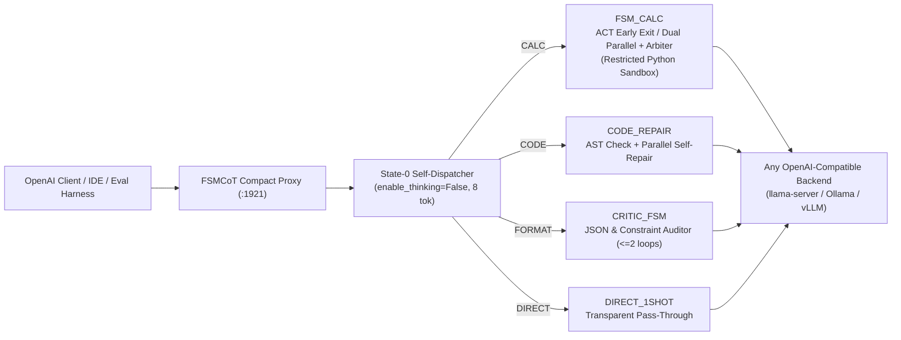

# 🚀 Aria FSMCoT Compact

**A Zero-Dependency, Single-File Finite-State Machine Chain-of-Thought (FSMCoT) OpenAI-Compatible Proxy**  
*Upgrade any small local LLM (4B–8B quantized models via `llama.cpp`, `Ollama`, `vLLM`, or `LM Studio`) with deterministic Python math verification, AST syntax self-repair, and constraint auditing — using **Python's standard library only**.*

> **日本語概要**: 外部ライブラリ依存ゼロ（Python 標準ライブラリのみ）・単一ファイルで動作する、OpenAI 互換の軽量「思考 OS（FSMCoT）」プロキシです。`llama-server` / `Ollama` / `vLLM` / `LM Studio` などの前に置くだけで、4B〜8B クラスの小型ローカル LLM の数学・コード・厳密フォーマット精度を大幅に引き上げます。

---

## ✨ Key Features

- **Zero External Dependencies**: Pure Python 3.10+ standard library (`pip install`不要). No Obsidian, no vector DB, no PyTorch required.
- **Zero-Regex State-0 Self-Dispatcher**: Routes every request via a 10-line declarative prompt (`enable_thinking=False`, `max_tokens=8`) into 4 clean execution states:
  1. **`CALC` (`FSM_CALC`)**: Never relies on mental arithmetic. Uses **ACT Early Exit** for simple math, and **Multi-Head Parallel Dual Verification + Arbiter** for complex DP/combinatorics/search inside a restricted Python sandbox (`math`, `fractions`, `itertools`, `collections` only; zero OS/filesystem/network access).
  2. **`CODE` (`CODE_REPAIR`)**: Fast code generation + deterministic **AST syntax & unclosed-fence check** + parallel DCA/Forget-Gate self-repair on syntax/truncation errors.
  3. **`FORMAT` (`CRITIC_FSM`)**: Draft → deterministic constraint audit (strict JSON, word/char limits, uppercase) → up to 2 targeted repair loops.
  4. **`DIRECT` (`DIRECT_1SHOT`)**: Transparent pass-through for everyday chat, QA, summaries, and native tool calls, with an automatic short-budget (`max_tokens <= 512`) thinking-overflow guard.
- **RLT Continuous Session State Tape**: Pass `"user": "my-session"` (or `"fsmcot_session_id"`) to carry verified answers and defined functions across multi-turn conversations without context resets.
- **Built-in Live Dashboard**: Open `http://127.0.0.1:1921/` in your browser to inspect live routing and repair stats.

---

## 🧠 Architecture



---

## 📊 Reference Benchmark Highlights (4B Q4_K_M Local Model)

Measured with a local 4B Q4_K_M model (`llama-server`) behind the FSMCoT architecture:

| Benchmark | Raw Local 4B | With FSMCoT Proxy | Gain |
| :--- | :---: | :---: | :---: |
| **gBench Golden (14 text tasks)** | 12 / 14 (85.7%) | **14 / 14 (100.0%)** | **+14.3 pt** |
| **GSM8K (Math Word Problems)** | 62.6% | **94.00%** | **+31.4 pt** |
| **HumanEval (Full 164 tasks)** | 74.39% | **87.80%–90.85%** | **+13.4–16.5 pt** |
| **Multi-Category Hard Suite (16 tasks)** | 12 / 16 (75.0%) | **16 / 16 (100.0%)** | **+25.0 pt** |

*(Note: Full-scale numbers above come from the internal research suite; actual gains depend on your upstream model and backend settings.)*

---

## ⚡ Quick Start (30 Seconds)

### 1. Start your OpenAI-compatible backend
For example:
- **llama.cpp**: `llama-server -m your-model.gguf --port 1918`
- **Ollama**: `ollama serve` (`http://127.0.0.1:11434`)
- **vLLM**: `vllm serve ... --port 8000`

### 2. Launch FSMCoT Compact
```bash
# Default (connects to http://127.0.0.1:1918, listens on http://127.0.0.1:1921)
python fsmcot_gateway.py

# With Ollama
python fsmcot_gateway.py --upstream http://127.0.0.1:11434 --no-slot-pin

# With vLLM or LM Studio
python fsmcot_gateway.py --upstream http://127.0.0.1:8000 --port 1921 --no-slot-pin
```
- **Windows**: Double-click `Start_FSMCoT_Compact.bat`
- **Linux / macOS**: `chmod +x start_fsmcot_compact.sh && ./start_fsmcot_compact.sh`

### 3. Call it like standard OpenAI API
```bash
curl http://127.0.0.1:1921/v1/chat/completions \
  -H "Content-Type: application/json" \
  -d '{
    "model": "fsmcot-compact",
    "user": "demo-session",
    "messages": [
      {"role": "user", "content": "What is 15 * 3 - 12 / 4?"}
    ]
  }'
```

### 4. Run Offline Smoke Tests
```bash
python test_smoke.py
```

---

## ⚙️ CLI Options & Environment Variables

| Flag | Env Var | Default | Description |
| :--- | :--- | :--- | :--- |
| `--host` | — | `127.0.0.1` | Bind host |
| `--port` | — | `1921` | Proxy listen port |
| `--upstream` | `FSMCOT_UPSTREAM` | `http://127.0.0.1:1918` | Upstream OpenAI-compatible base URL |
| `--model` | `FSMCOT_MODEL` | *(auto-detect)* | Override upstream model ID (otherwise auto-resolved via `/v1/models`) |
| `--api-key` | `FSMCOT_API_KEY` | `""` | Optional Bearer token for upstream |
| `--no-slot-pin` | — | `False` | Disable `llama.cpp`-specific `id_slot=0` KV pinning |

- Pass `"fsmcot_raw": true` in any request body to bypass routing and proxy directly to upstream.
- Pass `"fsmcot_reset_session": true` to clear the RLT Continuous State Tape for that session.

---

## 🛡️ Security Note

`FSM_CALC` executes LLM-generated arithmetic/combinatorics snippets using a restricted `exec()` environment with a strict builtins whitelist and import allowlist (`math`, `fractions`, `itertools`, `collections`). For untrusted multi-tenant deployments, run this proxy inside a container or OS sandbox.

---

## 📄 License

MIT License — see [LICENSE](LICENSE).
